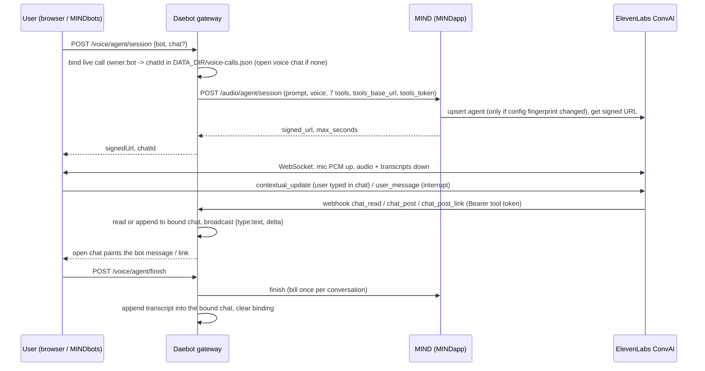

# MIND bot voice agent: live-call chat tools

Status: design + first slice (branch `feat/mind-voice-agent-chat-tools`). Requested by Anthony, Nov 13 2026. Modeled on the Grok Bot voice agent: during a live call the bot can read the chat, post into it (even mid-sentence), and drop links into it.

## What already exists (reused)
| Piece | Where | What it does |
|---|---|---|
| Voice chat gateway | `agent/src/gateway/voiceagent.ts` | `/voice/agent/{llms,session,finish}`; builds the per-bot agent config; serves ElevenLabs webhook server tools at `/voice-agent/tools/*` authenticated by an HMAC tool token per (owner, bot). |
| Existing tools | same | `list_sessions`, `read_session`, `search_chats`, `post_to_session` (posts as the user and triggers a bot turn). |
| Wiring | `agent/src/gateway/index.ts` (~L353) | botOf, saveTranscript, tools backend over the session manager; `broadcast(id, ev)` pushes live events to WebSocket subscribers of that chat. |
| Transcript append | `agent/src/runtime.ts` `appendVoiceTranscript` | Appends user/agent lines to a session and persists. |
| Browser client | `agent/web/voiceagent.js` | Opens the signed ElevenLabs WebSocket, streams mic PCM, plays audio, handles `interruption` (barge-in by voice). Passes the open session id as `chat` when it has one. |
| Chat → call helper | `agent/web/voicechat-bridge.js` | Pure function: a chat event becomes an ElevenLabs client message, or nothing. |
| Start tool | `agent/src/bots/voicechat-tool.ts` | Bot tool `start_voice_agent`. |
| One-shot voice | `agent/src/gateway/voice.ts` | STT/TTS proxy through MIND (`/audio/transcriptions`, `/audio/speech`). |
| MIND side | `theastraway/MINDapp` `backend/services/daebot_voice_agent.py` | Holds the ElevenLabs key, keeps ONE ElevenLabs agent per (account, bot), registers Daebot's tools as webhook tools (max 12, string params), signs the URL, gates spend caps and bills per conversation (`CONVAI_USD_PER_MINUTE`). |
| MINDbots app | `theastraway/MINDapp` `desktop-agent-sync/` (v1.6.0) | Electron shell for agent sessions; Daebot bots + MIND Voice surface there. |

Env var names involved (values never in code or docs): `DAEBOT_PUBLIC_URL` (public base for tool webhooks); MIND holds the ElevenLabs API key server-side. No Twilio, LiveKit, OpenAI Realtime or xAI realtime code is in daebot today.

## Architecture

### Realtime voice loop
Unchanged: browser ↔ ElevenLabs over the signed WebSocket (ElevenLabs does VAD, turn taking, STT, LLM, TTS). MIND only signs and bills; the ElevenLabs key never leaves MIND.

### Tools the voice model can call (new)
- `chat_read(limit)`: last N (1..50, default 20) messages of the call's chat, also capped at 6000 characters. Same `User:` / `Assistant:` transcript as `read_session`, plus `chat_id`.
- `chat_post(text)`: post as the bot into the call's chat (max 2000 characters). Does not start a bot turn. `ToolBackend.say` resumes the session, `appendVoiceTranscript` with role `agent`, then `broadcast(id, { type: "text", delta })`.
- `chat_post_link(url, label)`: absolute `https:` only (`new URL`), unless `allowHttpLinks` is set (gateway: env `DAEBOT_VOICE_ALLOW_HTTP_LINKS=1`). Rejects `http:` by default, and always rejects `javascript:`, `data:`, `file:`, credentials (`user:pass@`), and URLs longer than 2000 characters. Label is at most 120 characters with ``, carriage returns and newlines removed; default label is the hostname. Posted as `[label](url)` via `say`. Returns `{ ok: true, posted }`. The tool description and the prompt say "https only" unless http is opted in, in which case they say "http or https".
All three are scoped to the live call's chat via a server-side binding (`owner` + bot slug → `{ chatId, startedAt, expiresAt }`, expires at max call length or 900s, plus 60s). The binding is one JSON file, `DATA_DIR/voice-calls.json` (same disk as sessions; atomic tmp + rename). Every lookup re-reads the file, so a restarted process and any other gateway process that shares that directory see the same row. Expired entries are ignored and removed on the next lookup. There is no other shared store (no SQL, no KV): two gateways that do not share `DATA_DIR` do not see each other's calls. A whole-file rewrite can lose a concurrent write of a different row; a call is one row and writes are rare. The tool token stays per (owner, bot), so MIND's cached ElevenLabs agent is not re-created per call. No live call answers HTTP 200 `{ error: "No live call chat. Start voice chat from a chat first." }`. With no file path (unit tests) the book stays in that process.

`/voice/agent/session` takes optional `chat`. It must be a session `tools.read(owner, id)` can see, otherwise 404, and that check happens before MIND is called. With no `chat`, `openCallChat` opens the same `surface: "voice"` thread `saveTranscript` used to open at the end.

### Interrupt / barge-in
- User barges in by voice: ElevenLabs sends `interruption`; the client stops playback (exists).
- Bot interrupts itself to post: the prompt allows stopping mid-sentence, calling `chat_post` / `chat_post_link`, then saying "I put it in the chat." Tool calls are synchronous webhooks (20 s timeout) so the post lands before the agent resumes.
- User interrupts by typing: `web/voicechat-bridge.js` maps a user message to `{ type: "contextual_update", text: "User typed in chat: ..." }`. A message that starts with `!`, or one sent with `interrupt: true` while the agent is speaking, maps to `{ type: "user_message", text }` and `stopPlayback: true`. `voiceagent.js` `onChatEvent` sends that message and stops playback. The agent's own `chat_post` (`type: "text"` / assistant / `fromAgent`) is dropped.

### Chat → live call context
The page passes `chat` (the open session id) when `state.currentId` is set. While the call is live, a new message the user types in that chat is sent into the ElevenLabs socket:

- `app.js` `sendMessage` (the composer, the queue, and a retry) calls `tellCall(id, { type: "user", text, interrupt: true })` once the session id is known, before the SSE read. `interrupt` barges in only while audio is playing; a leading `!` always does. `replyInto` uses the same call when the board sends into a chat that is not the one on screen.
- `attachRun` (a turn this tab did not start) calls `tellCall` for `ev.type === "user"` only.
- While the chat is idle, `reconcile` uses `newUserTexts` (`web/sync.js`) and forwards only user lines that were not already on screen. A first paint (no previous user lines) forwards nothing, so opening the chat does not replay it into the call. An assistant-only `chat_post` changes text length, not the user list, so it is never sent back.

`tellCall` drops the event unless `sessionId` is `voiceChat.chatId()`. `onChatEvent` then drops assistant text, `fromAgent`, and anything that is not a user message.

### How an open chat shows a post
`broadcast` delivers `{ type: "text", delta }` to WebSocket subscribers. That is the assistant-text event the web client already renders. The web app itself does not hold a socket on an idle chat. It re-reads history every few seconds. `transcriptBehind` (`web/sync.js`) treats a change in assistant-text length as the thread being behind, once it has a baseline, so a `chat_post` shows up on the next poll without a new user message. `itemsFromHistory` ends an assistant bubble on `done`, so text written after a finished turn is its own message.

### Auth and tenancy
Tool calls carry the HMAC token for (owner, bot); the live-call map is keyed by that pair, and every lookup is scoped to that owner, so another owner's chat is "not found". The session route only binds a chat the signed-in user owns. Posting as the user (`post_to_session`) stays gated on the user asking; `chat_post` writes only to the call's own chat.

### finish
`/voice/agent/finish` appends the merged transcript into the bound chat (`saveTranscript(..., chatId)` resumes it instead of opening a new thread) and clears the binding. If the transcript does not land, the binding stays so a retry still targets that chat. No binding, or an expired one, keeps the old behavior: open a new voice thread. A 202 from MIND (transcript not ready) does not clear the binding.

### Latency
Webhook round-trip to Daebot is in-process reads/appends (single-digit ms) plus ElevenLabs → Daebot network time. `chat_read` caps output at 6000 chars to keep the LLM turn short. No extra LLM call is added.

### Reused vs new
Reused: ElevenLabs session flow, MIND signing/billing/spend caps, tool-token auth, transcript save, WebSocket broadcast, history poll, the data-dir JSON file (tmp + rename) every other ledger uses. New: live call file, 3 tools, `say`, prompt paragraph, finish-into-bound-chat, `openCallChat`, browser bridge + `onChatEvent` wired from the chat page, history poll noticing assistant-only posts.

## Out of scope (later)
- Grok Bot–style meeting join (Meet/Zoom/Teams) with a call-side chat; phone (Twilio) calls.
- A non-ElevenLabs realtime provider (xAI / OpenAI Realtime / LiveKit).
- MINDbots desktop (`desktop-agent-sync`) UI to start a call from an agent session.
- A binding store other than the shared data directory. Two gateways on different disks do not share a live call.
