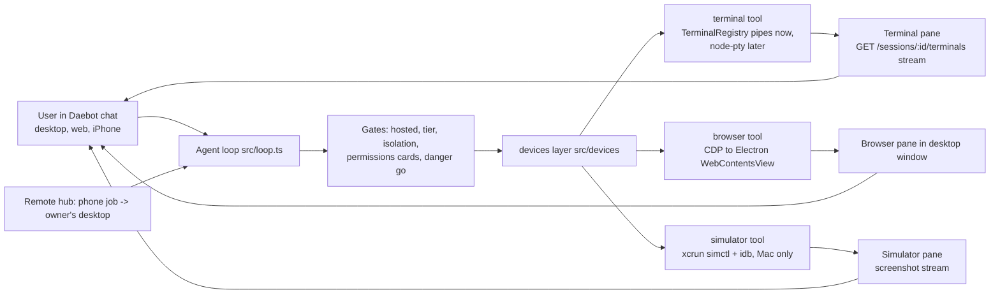

# Daebot devices scope: iOS simulator, own browser, and terminal

Daebot devices scope for theastraway/daebot, written Nov 13 2026 on request from Anthony via Daebot Build. Three new Daebot capabilities modeled on Claude Code: (1) an iOS simulator the bot drives, (2) Daebot's own browser that the agent drives, (3) a user-visible terminal. Base: daebot main 8a076fc (v0.3.46). First slice branch: feat/daebot-devices-terminal. Nothing merged.

## 1. What already exists in daebot (paths under agent/)

Process model: the desktop app (agent/desktop, Electron 43.7.7, electron-builder 26.17.0, asar false) spawns the gateway as a child process (desktop/src/lib/child.mjs). The gateway is a bun-compiled binary (`bun build --compile src/cli.ts`) that embeds the web UI (agent/web, plain JS, no bundler) and serves it to one BrowserWindow (desktop/src/main.mjs createWindow, sandboxed, contextIsolation, in-memory partition "mindclaw"). Tools run in the gateway process, not in Electron.

Computer use and screen
- src/tools/computer.ts: `computer` tool, screenshot/click/type/key/scroll/drag. Windows via PowerShell + user32 (src/tools/ps.ts), Mac via src/tools/computer-mac.ts (screencapture + sips, JXA CoreGraphics for mouse, System Events for keys). No native module. Supported on win32 and darwin only (computerToolSupported). Dry-run mode DAEBOT_COMPUTER_DRY_RUN.
- src/tools/app.ts, src/tools/app-mac.ts: `app` tool, background UI Automation / accessibility tree control, win32 and darwin.
- src/tools/screen.ts + src/screen/feed.ts + src/gateway/screen.ts + desktop/src/lib/screen-capture.mjs, screen-frame.mjs, screen-permission.mjs: live screen feed. Desktop captures JPEG frames with desktopCapturer and POSTs /screen/frame to the local gateway; `screen` tool reads the ring buffer (look, wait_for_change, clip, save). Gated by the user's "Let Daebot watch my screen" switch and OS permission. Hosted 404.
- src/routing.ts: tool-choice routing text plus hard guards; `computer` may never open or type into a terminal (terminalGuard, no override).
- Screenshots reach the model as ToolResult.images (data: URLs, src/types.ts), never persisted.

Browser
- None. No Playwright, puppeteer, CDP, BrowserView or WebContentsView anywhere in agent/ (searched src, desktop, web). Only src/tools/web.ts `web_fetch` (HTTP fetch + htmlToText) and web_search on hosted. The desktop app has a second BrowserWindow only for MIND sign-in (partition "daebot-signin").

Terminal and shell
- src/tools/bash.ts `bash` (one-shot), src/tools/process.ts `process` (background jobs: start/status/tail/kill, 64 KB tail, 16 running).
- src/tools/terminal.ts `terminal` (already shipped): interactive hidden shell sessions, actions open/send/read/signal/close/list. Pipes, not a PTY (comment: a PTY needs a native module per Electron ABI and the 4-platform release has none), so vim/top/less do not work. Owned by chat session id; 256 KB ring buffer, 30 KB per read, 8 per chat, 16 per machine, 30 min idle reap, killed when the gateway exits. Shells bash, pwsh, powershell (Windows), cmd (Windows). Ctrl-C via pkill -INT -P on Unix, child Stop-Process on Windows.
- Gap vs Claude Code: the user cannot see any of it. No terminal pane, no PTY, no node-pty, no xterm.js.

Tool registry, permissions and approvals
- src/tools/index.ts createBuiltinTools: read_file, write_file, edit_file, glob, grep, bash, process, terminal, web_fetch, apple_calendar, plus app/screen/computer by platform, decide with a key.
- src/runtime.ts: bash, process, terminal, write_file, edit_file kept only with localTools. src/hosted.ts hostedToolAllowed: hosted never runs a shell. src/kernel/tier.ts: public tier drops bash/process/terminal.
- Tool classes (src/types.ts ToolClass): read, write, outward, irreversible, public; per-call classFor (src/tool-class.ts).
- src/kernel/danger.ts dangerGate: outward and irreversible calls need an explicit user go ("send it", "do it"), single-use, bound to the exact call signature.
- src/permissions/{index,rules,store}.ts: per-owner permission cards with server-generated scope options (exact, prefix, glob, domain, cwd, readonly, action). terminal send is treated as a command line; a bash deny rule also bans typing it into a terminal.
- src/kernel/isolation.ts: blocks writes into ~/Documents/GitHub repos outside worktrees, including through terminal send.
- Device relay (src/gateway/device-relay.ts, src/tools/apple-calendar.ts): a tool with `requires: "<capability>"` is offered only when the client lists that capability on send; the gateway publishes a device_call event and the client answers at /sessions/:id/device-result. Today only apple_calendar. This is the pattern for a client-side device.
- Remote hub (src/remote/hub.ts): a message to a bot thread from phone or web becomes a job for the owner's desktop, which runs it with local tools. This is how a Mac host is reachable from the iPhone app.

Bots and web
- agent/src/bots (talk-tool, manage-tool, voicechat-tool, store) and src/loop.ts: bots run the same loop and tool set; per-turn capabilities and device bridge are passed in tool ctx (loop.ts ~line 599).
- agent/web: app.js, toolroll.js (tool cards), screen.js (screen watch UI), sync.js, voiceagent.js.
- agent/ios and agent/android: Capacitor shells around the web UI.

MIND memory: no earlier daebot work on a simulator, an agent browser or a terminal pane. MIND holds the Claude Code reference contracts: iOS simulator control (attach opens a live panel first, headless screenshot/tap/text for verification, Mac + Xcode only, clear errors for xcode-select/missing Xcode, simulator reaches host localhost) and the built-in browser pane (preview_start, read_page / get_page_text preferred over screenshots, computer click/type, form_input, tabs_context; isolated from the user's Chrome; user sees the same pane and can take over; sites may need the user's allow).

## 2. Architecture

One "devices" layer: each device is a gateway-side tool backed by a host adapter, plus a user-visible pane in the web UI streamed over a local-only gateway route. Hosted deployments never mount any device (404), same as /screen. A new src/devices/index.ts reports what this host supports (first slice ships the status seam and GET /devices).

### 2a. Terminal (slice 1, then PTY)
- Now: keep the existing TerminalRegistry and terminal tool (its open/send/read/signal/close/list map to the asked-for term_open/term_write/term_read/term_kill; no duplicate tool). Add a read-only live pane: registry peek and subscribe that never move the agent's read cursor, local gateway routes GET /sessions/:id/terminals, /:tid, /:tid/stream (SSE), and agent/web/terminal-pane.js.
- Later PTY: node-pty in the desktop Electron main process, not in the bun-compiled gateway (bun cannot load a node-pty .node built for Electron's ABI, and the gateway ships as a single binary). The gateway asks the desktop over a local authenticated channel (same shape as /screen frames, reversed), xterm.js vendored into agent/web for the pane, and the user can type into it. Windows uses ConPTY (node-pty's default on Windows 10 1809+); Unix uses forkpty. Gateway-only installs (CLI, server) keep the pipe backend.
- Packaging for node-pty: native dep rebuilt per Electron ABI and per arch (@electron/rebuild, or electron-builder npmRebuild with buildDependenciesFromSource on the matching host). Win x64 and arm64 each need their own build; Mac universal needs arm64 and x64 .node merged or both shipped (x64ArchFiles or a lipo step); Linux x64. asar is false in this config, so asarUnpack is not needed today; if asar is ever turned on, add asarUnpack: ["**/node_modules/node-pty/**"]. Windows signing (the Azure Artifact Signing branch) must also sign conpty.dll / winpty binaries it ships. Mac hardened runtime: node-pty's spawn-helper must be signed with the app.
- Safety: cwd defaults to the chat's cwd and goes through the isolation gate; every send goes through the same permission rules as bash (prefix/exact allow, bash denies apply); destructive patterns (rm -rf, git push --force, deploy commands) classify as irreversible and need the user's go; output capped (256 KB buffer, 30 KB per read, ANSI stripped for the model); 30 min idle reap; sessions owned by one chat; shared-thread guests can never see a pane (secrets); hosted never.

### 2b. Browser
- Recommended: a Daebot-owned browser pane inside the desktop window, an Electron WebContentsView in its own persistent partition ("persist:daebot-browser", never the app's "mindclaw" partition and never the user's Chrome profile). The desktop main process attaches webContents.debugger (CDP 1.3) and exposes a small local API to the gateway; the gateway's `browser` tool calls it. Playwright-over-CDP is optional (playwright-core connectOverCDP to an Electron started with a remote-debugging port), but it adds a large dependency and opening a debugging port is a local attack surface, so start with the built-in debugger API.
- Tools (one `browser` tool with actions, like terminal): tabs, open {url}, navigate, back, read (accessibility tree / page text with element refs, preferred), screenshot (JPEG to ToolResult.images and the chat), click {ref|x,y}, type {ref,text}, key, scroll, wait_for {text|selector}, close. Read-first like Claude Code's read_page / get_page_text.
- Headless on the server: not for daebot.live (hosted runs no host-level tools). A local headless Chromium (CLI installs without Electron) is a later fallback using the same tool contract.
- User-visible pane: the user watches it live and can take over (pause the agent on user input in the pane).
- Isolation and safety: own partition; cookies stay in it; the tool never returns cookies, localStorage, form values of password fields or Authorization headers; navigation to file:, chrome:, devtools: and the gateway's own origin is refused; downloads go to a sandbox folder; typing into a password field or a field the page marks as payment (autocomplete cc-*) is refused unless the user does it; clicks that submit a form, a purchase, a send or a delete are classified outward/irreversible through classFor and need the user's explicit go (dangerGate) plus a permission card per domain (domain matcher already exists); page text is wrapped as untrusted (src/tools/untrusted.ts) so a page cannot instruct the bot.
- Platform limits: works on Mac, Windows and Linux desktop. Not in the iPhone/Android apps (they can drive the owner's desktop browser through the remote hub). Not hosted.

### 2c. iOS simulator
- Host: Mac only, needs Xcode and an iOS runtime installed (xcode-select -p pointing at Xcode.app, not CommandLineTools). Everything is xcrun simctl: list devices (simctl list -j), boot, shutdown, install <app>, launch <bundle id>, terminate, openurl, io <udid> screenshot, io recordVideo, privacy grant, ui appearance, status_bar override. Touch input: simctl has no tap. Options: idb (fb-idb companion, brew install, ui tap/swipe/text/describe-all gives an accessibility tree) or AppleScript/JXA CGEvents into the Simulator window (reuse computer-mac.ts, works without extra installs but needs Accessibility permission and takes over the mouse). Recommend idb when present, JXA fallback in-window.
- How the bot reaches it: a `simulator` tool in the gateway on the Mac desktop (spawn xcrun with argv, no shell, like computer-mac.ts). From the iPhone app or web, the owner's Mac is reached through the remote hub (a bot thread job runs on the Mac). Screenshots go back as ToolResult.images and into chat as a photo; a simulator pane in the web UI shows a 1-2 fps screenshot stream (same SSE pattern as the terminal pane), with a record-a-clip action using io recordVideo.
- Errors: when xcrun or a runtime is missing, return the exact fix (xcode-select -s /Applications/Xcode.app, install the iOS platform in Xcode Settings) and say it needs the user's password; never silently switch to screen control.
- Windows and Linux: not available. deviceSupport reports ios_simulator unavailable with the reason; the tool is not offered. Option for Windows/Linux users: run on a paired Mac through the remote hub, or a hosted Mac (MacStadium / EC2 mac) later. Android emulator (adb/emulator) is the cross-platform analogue for a later slice.
- Safety: only simulators, never a physical device; install only .app bundles built locally; simulator erase is irreversible (needs the go).

## 3. Ranked first-PR plan
1. Terminal pane, read-only (highest value, lowest risk: tool already exists, no new deps). PR: registry peek/subscribe, local SSE routes, terminal-pane.js, GET /devices status seam, tests. Effort: about 1 day. Tests: peek never steals the agent's output, ring overflow counts, subscribe/unsubscribe, owner scoping, guest 403, hosted 404, SSE snapshot then data, devices status per platform. Status: built on feat/daebot-devices-terminal.
2. Browser pane MVP. PR: WebContentsView in persist:daebot-browser, CDP via webContents.debugger, `browser` tool with open/navigate/read/screenshot/click/type/close, submit and purchase clicks classed irreversible, password/payment fields refused. Effort: 3-4 days. Tests: tool contract with a fake CDP; classifier for submit buttons; partition isolation; untrusted wrapping; an Electron smoke test (desktop npm run smoke) on Mac and Windows.
3. Terminal PTY upgrade. PR: node-pty in Electron main, gateway-to-desktop channel, xterm.js pane with user typing, electron-builder native rebuild per arch and Mac universal handling, signing of spawn-helper and conpty. Effort: 3-5 days, mostly packaging and CI per platform. Tests: PTY open/resize/write/read with a fake pty; packaging check that the .node for each arch is present; Windows ConPTY smoke.
4. iOS simulator MVP (Mac only). PR: `simulator` tool with list/boot/install/launch/openurl/screenshot/shutdown via simctl, tap/type via idb if installed, deviceSupport detection, pane with a screenshot stream. Effort: 2-3 days. Tests: fake xcrun exec with recorded simctl list -j output, argv never through a shell, unavailable on win32/linux, missing-Xcode error text. Needs a Mac with Xcode to verify for real.

## 4. Open decisions for Anthony
1. Terminal pane: read-only first (built), or let the user type into Daebot's terminal in slice 1b before the PTY work?
2. PTY: accept node-pty as the first native dependency in the desktop app (per-arch rebuilds, signing spawn-helper and conpty), or stay pipe-only?
3. Browser: built-in Electron debugger (no new deps, recommended) or Playwright-over-CDP (more features, big dependency, opens a debugging port)?
4. Browser sign-ins: may the agent use sites the user signs into inside Daebot's browser, and should that partition persist across restarts?
5. Simulator touch input: require idb (brew install idb-companion) or fall back to AppleScript/JXA screen control of the Simulator window?
6. Windows/Linux users and the simulator: reach a paired Mac through the remote hub only, or plan a hosted Mac?
7. Should these panes work from the iPhone app by driving the owner's desktop through the remote hub, or desktop only at first?
